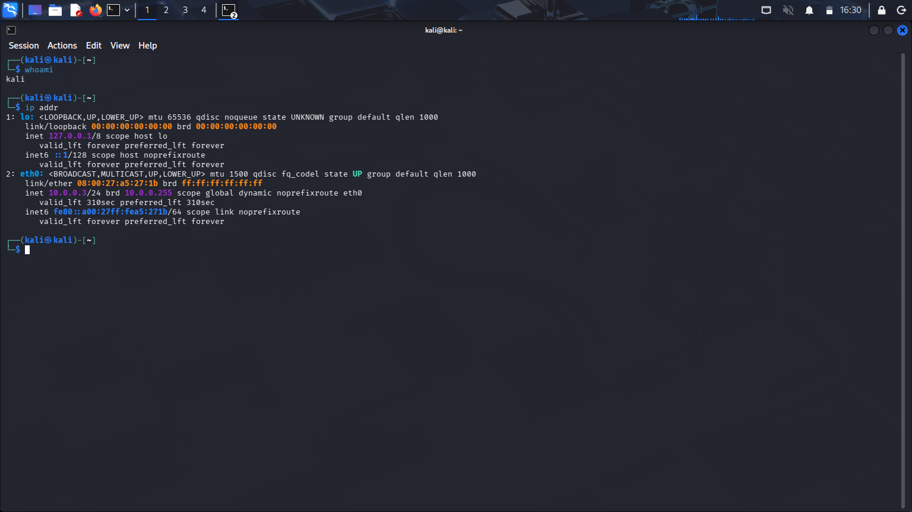

# CyberLab | Virtual Cybersecurity Environment

<p align="center">
  <strong>A documented virtual environment for cybersecurity learning and network fundamentals.</strong>
</p>

<p align="center">
  
  
  
  
</p>

## Overview

CyberLab is a learning project that documents the preparation of a virtual cybersecurity environment using Kali Linux and Oracle VirtualBox. It covers virtual machine setup, network configuration, basic diagnostics, snapshots, and structured troubleshooting documentation.

The project aims to establish a repeatable lab setup and maintain clear technical documentation. Features and test results are documented as they are completed and verified.

## Objectives

- Prepare a Kali Linux virtual machine for controlled learning.
- Understand virtual networking modes and document the selected configuration.
- Inspect IP addressing, routing, and DNS settings.
- Create a recoverable baseline using a virtual machine snapshot.
- Record setup issues, diagnostic commands, and verified resolutions.
- Build a foundation for future defensive security and monitoring exercises.

## Lab Architecture

```text
Host Computer
     |
Oracle VirtualBox
     |
Kali Linux Virtual Machine
     |
Configured Virtual Network
     |
Network Diagnostics and Lab Documentation
```

> This is a conceptual diagram. The actual network design should reflect the configuration used in the lab.

## Technology Stack

| Component | Role |
|---|---|
| Kali Linux | Linux and cybersecurity learning environment |
| Oracle VirtualBox | Virtual machine management |
| Virtual Networking | Network configuration and connectivity |
| GitHub | Version control and project documentation |
| Markdown | Technical guides and lab notes |

## Repository Structure

```text
CyberLab-Virtuabox-WK1-PM1/
├── README.md
├── SECURITY.md
├── CONTRIBUTING.md
├── CHANGELOG.md
├── LAB-NOTES.md
├── .gitignore
├── docs/
│   ├── installation-guide.md
│   ├── network-configuration.md
│   ├── validation-checklist.md
│   └── troubleshooting.md
├── screenshots/
│   ├── README.md
│   ├── kali-mainpage.png
│   ├── kali-network-info.png
│   ├── Screenshot 2026-10-30 020042.png
│   └── Screenshot 2026-10-30 020146.png
└── diagrams/
    └── README.md
```

## Prerequisites

- A computer that supports hardware virtualization.
- Oracle VirtualBox installed from its official source.
- A Kali Linux image from the official Kali Linux website.
- Sufficient memory and disk space for the chosen virtual machine configuration.
- Basic familiarity with terminal commands.

## Getting Started

1. Review the [installation guide](docs/installation-guide.md).
2. Create or import a Kali Linux virtual machine.
3. Review the [network configuration guide](docs/network-configuration.md).
4. Follow the [validation checklist](docs/validation-checklist.md).
5. Save genuine lab screenshots in the `screenshots/` directory.
6. Record actual observations and issues in [LAB-NOTES.md](LAB-NOTES.md).

## Lab Screenshots

### Kali Linux Desktop


### Kali Linux Network Information


### VirtualBox Main Interface


### VirtualBox Network Settings


## Basic Network Diagnostics

The following commands can be used to inspect the Kali Linux network configuration.

Display network interfaces and IP addresses:

```bash
ip address
```

Display the routing table:

```bash
ip route
```

Inspect DNS resolver settings:

```bash
cat /etc/resolv.conf
```

If internet access is expected, connectivity and DNS resolution can be checked separately:

```bash
ping -c 4 1.1.1.1
getent hosts example.com
```

A failed ping does not necessarily mean all connectivity is unavailable, because ICMP traffic may be blocked. Record actual command output before drawing conclusions.

## Validation Checklist

Update this checklist as each item is completed and verified.

- [ ] Kali Linux virtual machine boots successfully.
- [ ] The expected network interface is visible.
- [ ] IP address and subnet are checked against the intended configuration.
- [ ] The default route is inspected and understood.
- [ ] DNS resolver settings are inspected.
- [ ] Connectivity checks are performed and their results recorded.
- [ ] A baseline virtual machine snapshot is created.
- [ ] Screenshots are reviewed for sensitive information.
- [ ] Documentation reflects the configuration actually tested.

## Troubleshooting

Refer to the [troubleshooting guide](docs/troubleshooting.md) for common setup issues.

For package-manager lock errors, identify whether a package operation is already running and allow it to finish. Avoid deleting lock files manually or terminating package-management processes blindly.

## Responsible Use

Use this environment for education and authorized testing only. Keep intentionally vulnerable systems isolated from untrusted networks. Test only systems you own or have explicit permission to assess.

Do not commit passwords, private keys, access tokens, personal data, or sensitive network information.

See [SECURITY.md](SECURITY.md) for additional guidance.

## Roadmap

- [ ] Complete and document the virtual machine configuration.
- [ ] Record the selected network mode and relevant settings.
- [ ] Perform and document network validation.
- [ ] Record troubleshooting examples and confirmed resolutions.
- [ ] Add a defensive log-analysis exercise.
- [ ] Consider a second lab virtual machine when an appropriately isolated network is configured.

## Project Status

**Status:** In progress.

The initial lab environment and screenshots have been prepared. Network validation and other remaining steps will be documented as they are completed and verified.

## Author

**Name:** Taha Khan  
**GitHub:** [tahakhan0301](https://github.com/tahakhan0301)  
**LinkedIn:** [Connect with me on LinkedIn](https://www.linkedin.com/in/taha-khan-a34487245/)  
**Focus:** Cybersecurity | Linux | Networking
